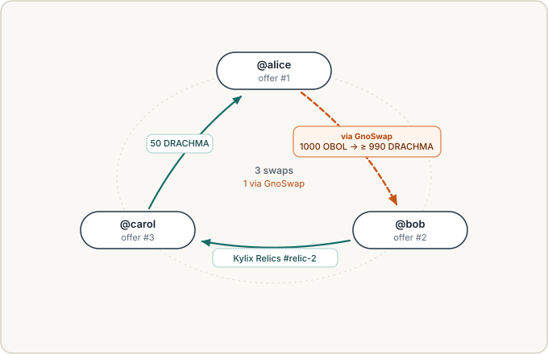

# Kylix

**Swap tokens and collectibles in a circle on Gno.land.** You post what you give and the least you will take for it. When two to six offers close a ring, they all settle in one transaction, or nothing moves. Kylix never holds your assets.

Built for the Gnome Tavern Hackathon. The name is the Greek cup that was passed round the circle at a drinking party.

**Live on the Gno.land testnet (onyx-1):** https://onyx.testnets.gno.land/r/nym-kylix000/kylix



## Why

Every market on Gno.land today is two-sided and priced in GNOT. That strands anything that has no GNOT buyer right now.

Ana has 100 OBOL and wants DRACHMA. Ben has a relic and wants OBOL. Cleo has DRACHMA and wants Ben's relic. No two of them can trade with each other, but all three can trade in a circle. Kylix settles that circle in one transaction. If one person in a ring wants a different token from the one they are offered, Kylix swaps it on GnoSwap on the way.

## How it works

1. **Approve one swap.** Each offer gets its own address. You approve that address for exactly the token amount, or the one item, you are offering. Your assets stay in your wallet.
2. **Post your offer.** "I give X, I want at least Y." For a token, or an item from an official collection, the realm accepts it only if you hold the asset and have approved it. You can cancel at any time. Every offer expires (7 days by default, 30 at most).
3. **Anyone settles the ring.** The realm checks that every offer in the ring gets at least what it asked for, then moves each asset straight from its owner to the next. If any step fails, the chain rolls the whole transaction back.

Whoever settles a ring receives the storage deposits that its offers and approvals had locked. In the honest rings we measured on a local chain, that covered the minimum fee, by a margin from about 0.06 GNOT up to 1.3 GNOT. It is an offset, not a guaranteed profit: a ring's assets can change between a simulation and the real transaction, and a crafted ring can cost the settler up to the deposit cap they set. So the solver prints a simulate command and a deposit cap with every settle command. There is no tip and no protocol fee.

## What is in this repo

| Path | What it is |
|---|---|
| `p/ring` | Pure package: ring verification and the ring picture (SVG). |
| `r/kylix` | The realm: offers, settlement, the GnoSwap hop, collection plug-ins, the page, notifications. |
| `r/kylixdemo` | Two demo tokens and a demo collection with a faucet, so a newcomer can trade in two minutes. |
| `r/adapters` | Adapters that let existing collections trade without redeploying: Sinopia3 artworks and MNS names. |
| `r/mocks` | Test-only stand-ins, including hostile collections. Never deployed. |
| `solver/` | Off-chain ring finder in Go, a command-line tool that prints settle commands, and an agent skill for gnomcp. |
| `scripts/` | One command to start a seeded local chain, a script that stages the packages for a namespace, and the step-by-step testnet rehearsal. |
| `docs/DESIGN.md` | The design, the decisions and the threat list. |
| `docs/research/` | The GnoSwap and collection studies and the security review. |

## Gno.land features it is built from

| Feature | The job it does in Kylix |
|---|---|
| Realm sub-addresses (`cur.Sub`) | One address per offer. An approval given to it can move only that offer's asset. |
| Crossing function values stored across realms | A collection registers its move function once; Kylix calls it as the offer's address and never lends its own authority. |
| `r/nt/grc20reg` | Any registered GRC20 token is tradable with no listing step. |
| GnoSwap router | Swaps one hop of a ring when the giver's token is not the token the receiver wants. |
| gnoweb (forms, buttons, columns, inline SVG, `r/sys/users`) | The whole interface is the realm's own page. There is no server. |
| Storage deposit refunds | Pay whoever settles or cleans up, with no extra code. |
| Session keys | An agent can post and settle for you but can never cancel your offers. |
| gnomcp | The solver skill lets an AI agent find rings and settle them. |
| gnotif | Each trader gets a notification when their swap settles. |

## Try it on the testnet

Everything happens on the realm's own page, with a wallet such as Adena set to the `onyx-1` testnet.

1. Open https://onyx.testnets.gno.land/r/nym-kylix000/kylix and follow **Get free demo assets**: the faucet at `r/nym-kylix000/kylixdemo` gives 1,000 OBOL, 1,000 DRACHMA and one relic per claim.
2. **Post an offer**: the page works out your offer's address, shows the approval to sign, then the offer to post.
3. When a ring is ready it appears under **Ready to settle** with its picture. Anyone can settle it.

The solver works against the testnet too:

```sh
cd solver && go build ./cmd/kylix-solver
./kylix-solver --rpc https://rpc.onyx.testnets.gno.land:443 --realm gno.land/r/nym-kylix000/kylix
```

| Deployed package | Path |
|---|---|
| Realm | `gno.land/r/nym-kylix000/kylix` |
| Ring verifier and picture | `gno.land/p/nym-kylix000/ring/v0` |
| Demo tokens and relics | `gno.land/r/nym-kylix000/kylixdemo` |
| Adapters | `gno.land/r/nym-kylix000/adapters/nsnft`, `gno.land/r/nym-kylix000/adapters/sinopia3` |

## Try it locally

You need a gno `v1.8.0` checkout (the version the testnet runs) and `gno`, `gnodev` and `gnokey` built from it.

```sh
make deps GNOROOT=/path/to/gno-v1.8.0   # once: reads dependency source from the testnet
make demo GNOROOT=/path/to/gno-v1.8.0
```

This starts an in-memory chain on your machine, deploys Kylix and seeds a small market from throwaway accounts. After `make deps` it needs no network at all. Open http://127.0.0.1:51888/r/nym-kylix000/kylix: the home page shows a ring of three offers ready to settle, and one offer sells a real MNS name registered on that chain. While seeding, the script also sells another MNS name through Kylix and checks that the buyer owns it. See [scripts/README.md](scripts/README.md).

Find and settle rings from the command line:

```sh
cd solver && go build ./cmd/kylix-solver
./kylix-solver --rpc http://127.0.0.1:51657 --realm gno.land/r/nym-kylix000/kylix
```

It prints the rings it found and, for each, a command to simulate the settlement and a command to send it, both with a cap on the storage deposit. It never signs or sends anything itself.

## Tests

```sh
make check integration GNOROOT=/path/to/gno-v1.8.0   # realm and adapters
cd solver && go test ./...                           # solver
```

The realm suite covers the threat list in `docs/DESIGN.md`, apart from what the test harness cannot express (a real session key, real rollback, a paid name registration), which is run on a local chain instead: an approval that cannot be reused for another offer, hostile collections that re-enter, lie about a move, panic or inflate storage, rings of the wrong shape, expired and cancelled offers, revoked approvals, session keys, a decoy GnoSwap pool, and look-alike tokens and collections. The adapter tests run against the real Sinopia3 and MNS source fetched from the testnet: Sinopia3 art is bought through its real minter, and for MNS the lease rules are unit-tested and the full path (a paid registration, then a sale through Kylix) runs every time `make demo` seeds the chain. The GnoSwap hop was also run against GnoSwap's real source.

## Add your collection

A collection becomes tradable by registering three functions. Kylix calls the first as the offer's own address.

```go
func init(cur realm) {
	kylix.RegisterItem(cross(cur), "My Collection", Move, OwnerOf)
	kylix.RegisterApprovalCheck(cross(cur), Approved)
}

// Move: Kylix calls it as the offer's own address (cur.Previous()). Use only
// an approval of this one item; the transfer clears it.
func Move(cur realm, from, to address, itemID string) error {
	tid := grc721.TokenID(itemID)
	if a, err := token.GetApproved(tid); err != nil || a != cur.Previous().Address() {
		return errors.New("approve this offer's address for the item itself")
	}
	return ledger.CallerTeller().TransferFrom(0, cur, from, to, tid)
}

func OwnerOf(id kylix.ItemID) address {
	owner, err := token.OwnerOf(grc721.TokenID(id))
	if err != nil {
		return ""
	}
	return owner
}

// Approved: an approval of this one item only, never IsApprovedForAll.
func Approved(id kylix.ItemID, spender address) bool {
	a, err := token.GetApproved(grc721.TokenID(id))
	return err == nil && a != "" && a == spender
}
```

Two rules. An item's id must fix its value: if the owner can change what the item is worth while it is listed, do not register it. And the approval Kylix uses must be used up by the move, which is why a blanket approval is refused.

A collection that is already deployed can be reached through an adapter realm instead; `r/adapters/sinopia3` and `r/adapters/nsnft` are working examples.

## What it costs

On the testnet, measured during the rehearsal described under Status:

| Action | Gas | Storage deposit |
|---|---|---|
| Approve | 6 to 7 million | 0.11 to 0.21 GNOT paid |
| Post an offer | 20 to 23 million (30 for an MNS name) | 0.06 to 0.10 GNOT paid; 0.5 to 1.0 for an account's first offer |
| Cancel | 11 million | 0.06 to 0.52 GNOT back to the owner |
| Settle 2 token offers | 26 million | 0.54 GNOT to the settler |
| Settle 3 offers (token, relic, token) | 34 million | 1.16 GNOT to the settler |
| Settle 2 offers, one an MNS name | 45 million | 0.44 GNOT to the settler |
| Settle 2 offers with a GnoSwap swap | 146 million | 0.79 to 1.20 GNOT to the settler |

A swap through GnoSwap is by far the heaviest step: about 118 million gas on the real chain, where a test run of GnoSwap's source had suggested 34 million. The ring page and the solver size the gas limit for it.

On a local chain, measured with real transactions on gno v1.8.0. Storage costs 100 ugnot per byte and is refunded to whoever frees it. The minimum fee is the gas limit divided by 1,000, in ugnot. The first three settle rows are for receivers who already hold the token they receive; a first-time holder's balance entry is charged to the settler, which the last rows show.

| Action | Gas | Storage deposit |
|---|---|---|
| Approve | 6 to 8 million | 0.11 to 0.21 GNOT paid |
| Post an offer | 19 to 22 million | about 0.055 GNOT paid |
| Cancel | 10 million | 0.052 GNOT back to the owner |
| Settle 2 offers | 24 to 30 million | 0.32 to 0.63 GNOT to the settler |
| Settle 3 offers | 33 to 36 million | 0.78 GNOT to the settler |
| Settle 2 offers, both receivers new to their token | 29 million | 0.12 GNOT to the settler |
| Settle 6 token offers, all six receivers new to their token | 39 million | 0.16 GNOT to the settler |
| Settle 2 offers, one an MNS name | 37 million | 0.43 GNOT to the settler |
| Settle 6 item offers, all six receivers new to the collection | 60 million | 0.13 GNOT to the settler |

## Safety, and what Kylix does not protect you from

- **No custody and no admin key.** Nobody, including the authors, can move, freeze or seize anything.
- **Your approval is good for one offer only.** It names one address, that address acts only for the offer it was made for, and the approval must be for exactly the amount offered, or for that one item. A blanket approval of all your items is not accepted.
- **Look-alikes are labelled.** Anyone can publish a token called GNS. The offer, ring and post pages show an asset's full realm path beside its name, shorter listings carry a hint of the realm, and collections are marked official or third-party.
- **On a GnoSwap hop, your minimum is your price.** Anyone can arrange the pool so that you receive exactly your minimum and no more. Ask for what you want to receive.
- **Third-party collections are labelled, not blocked.** A collection's own code decides what its items are. If you ask for an item from a collection you do not know, you are trusting that collection.
- **Settling runs collection code at the settler's cost.** A hostile collection can make the settler pay storage deposit. The solver caps the deposit on every command and skips third-party collections unless told otherwise. Posting, cancelling and pruning never run a third-party collection's code.
- **Only items with a fixed value.** GnoSwap liquidity positions are not supported: their owner could empty one in the same transaction that sells it. An MNS name is accepted only with at least 31 days of lease left, and Sinopia3 art is refused until it is final.

Four rounds of independent review, by a different model from the one that wrote the code, found thirty issues between them, including that last one. Each is fixed or documented: [first review](docs/research/security-review-1.md), [second](docs/research/security-review-2.md), [third](docs/research/security-review-3.md), [fourth](docs/research/security-review-4.md). What remains is griefing that costs the attacker money: for example, 48 real, funded offers from 12 accounts can push an honest ring off the home page for as long as they stay open.

## Prior art

Settling trades in rings is not new. Loopring's order rings and CoW Protocol's ring trades do it for tokens on Ethereum, with off-chain solvers. On Gno.land, `netting` clears GNOT debts inside a club, and the existing markets are two-sided and GNOT-only. Kylix brings ring settlement to Gno.land and extends it across tokens, collectibles and any realm's items, with the per-offer addresses and stored cross-realm callbacks that Gno's realm model makes possible.

## Status

Live on the `onyx-1` testnet under the namespace `nym-kylix000` since 26 November 2026.

Before the realm was deployed at its permanent path, an identical copy was deployed under a throwaway address and rehearsed with real transactions (`scripts/testnet-rehearsal.sh`):

| Step | Result on the testnet |
|---|---|
| A ring of three direct offers (token, relic, token) | Settled with the command the solver printed; every asset moved; the settler ended 1.11 GNOT ahead |
| Refusals | A ring that does not close, a cancel by a non-owner, a reused approval, a post without approval and a blanket approval were all refused |
| A ring with a GnoSwap swap, by `SettleRing` and by `SettleRingVia` | Both settled against the real wugnot/GNS pool; the receiver got the quoted amount; Kylix's settle address held nothing afterwards |
| An MNS name sale | A name was registered, sold through the adapter and is owned by the buyer |
| A session key | Posted and settled; refused on cancel |
| Notifications | Refused for an account that does not own the namespace, accepted for the owner; a settlement emitted one event per trader |

Not shown on the testnet: a Sinopia3 sale. Every artwork the adapter accepts is held by two addresses and none is listed, so that adapter is covered by tests against the real Sinopia3 source only.

The rehearsal changed the code twice. A real GnoSwap swap needs about 118 million gas, so the gas limit for a ring with a swap went from 85 to 185 million. And a ring with an MNS name ran a hair over its 44 million limit, which is now 55 million.
